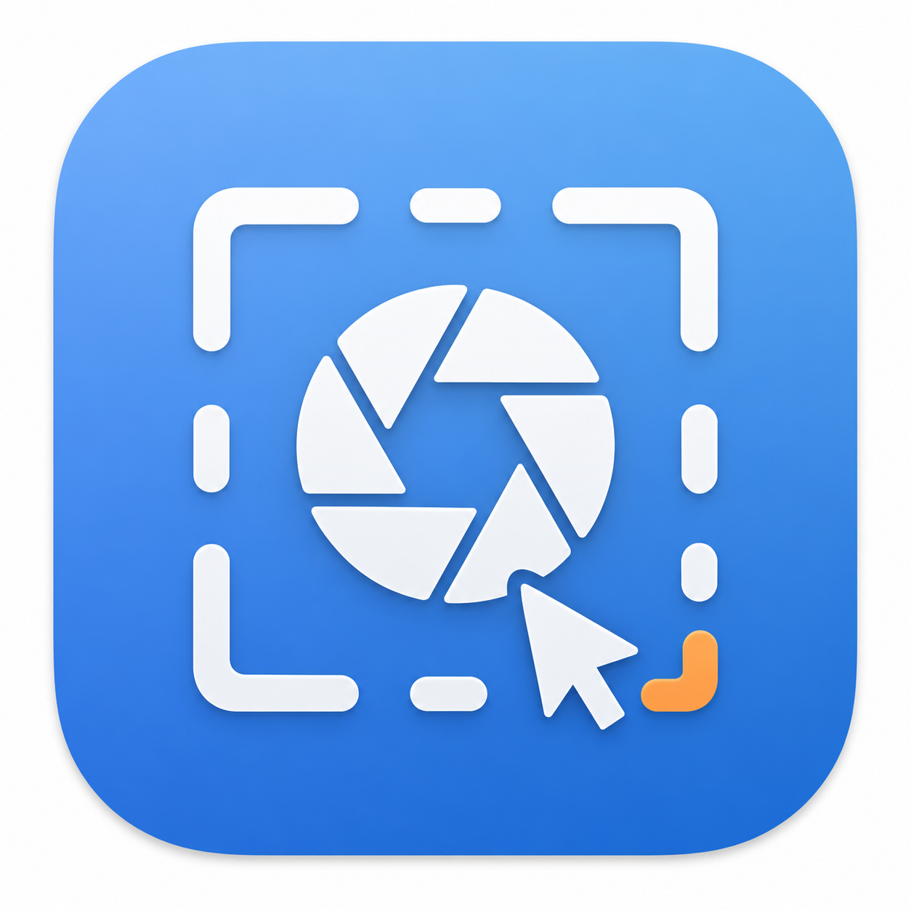
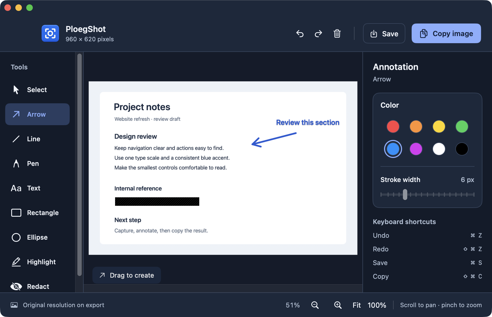
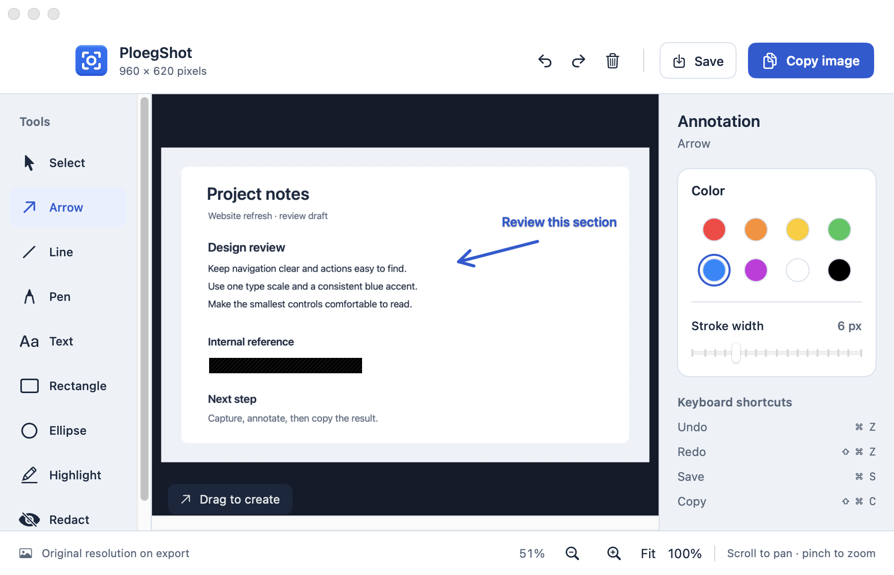

  

<h1 align="center">PloegShot</h1>

Capture, annotate, and share screenshots on your Mac.

  <a href="https://github.com/teunvanderploeg/PloegShot/releases/latest/download/PloegShot-macOS-AppleSilicon.dmg"><strong>Download for Mac</strong></a> ·
  <a href="https://github.com/teunvanderploeg/PloegShot/releases/latest">All releases</a>

Apple silicon · macOS 13 or later · Beta

Capture an area, the previous area, or a full display with a global shortcut.
Add arrows, text, highlights, and shapes. Redact private details, then copy,
save, or drag the result into another app.

Native SwiftUI and AppKit. Retina-resolution exports. Editable annotations,
undo and redo, and a floating preview that keeps recent captures within reach.
The screenshots above use the app's built-in demo document.

## Get started

Open the disk image and drag PloegShot to Applications. Allow Screen Recording
when macOS asks on your first capture.

Redactions become permanent in copied and saved images. Zoom never changes
export resolution.

## Updates

Updater-enabled builds check for new releases daily. Use **Check for Updates…**
in the menu bar, or open **Settings → About** to check manually and change update
preferences. Automatic download and installation are optional. Updates use signed
downloads and a signed feed hosted with GitHub Releases.

Existing versions need one manual installation of an updater-enabled release.
Copy or save captures before restarting to install an update.
See [release preparation and publishing](docs/updating.md) for the build script,
signing setup, and rollout steps. The feed becomes available when the first
updater-enabled release is published.

## Development

See the [development guide](docs/development.md) for local setup, preview modes,
tests, and architecture. Release signing and publishing are covered in the
[updating guide](docs/updating.md).
